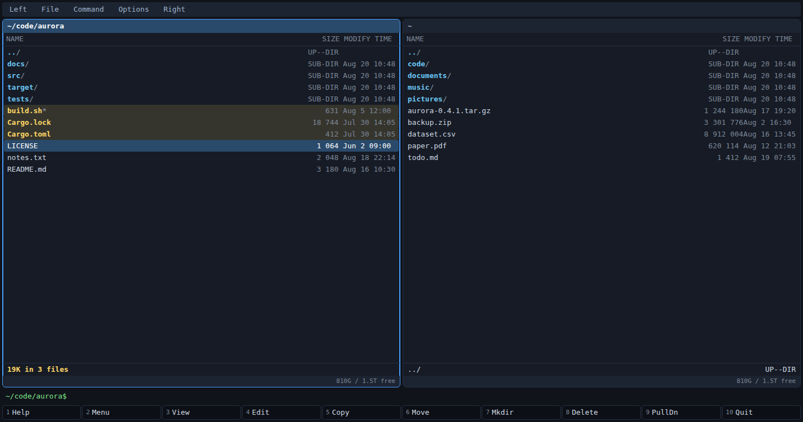

# mcx — Midnight Commander eXtended

An orthodox file manager with mc's keyboard and a modern surface: two panels, a
function-key row, and everything F1–F10 has meant since 1994. Built on
[aio](https://github.com/riagentic/aio), with the hot paths in Rust/wasm.



## Install

```sh
curl -fsSL https://raw.githubusercontent.com/riagentic/aio/main/run.sh | sh -s riagentic/mcx
```

Or in three steps:

```sh
curl -fsSL https://raw.githubusercontent.com/riagentic/aio/main/install.sh | sh  # 1 · aio
git clone https://github.com/riagentic/mcx && cd mcx                            # 2 · clone
am fix && deno task dev                                                         # 3 · run
```

## What it does

| Area       | Keys                              | Notes                                                   |
| ---------- | --------------------------------- | ------------------------------------------------------- |
| Panels     | `Tab` `C-u` `M-i` `M-t` `M-.`     | brief/full/long, sort, filter, info · tree · quick view |
| Navigation | arrows, `C-s`, `M-c`, `C-\`       | type-ahead, quick cd, hotlist, `$VAR` and `cd -`        |
| Selection  | `Ins` `+` `-` `*`                 | masks, invert, totals in the status line                |
| File ops   | `F5` `F6` `F7` `F8` `C-x c/o/s/l` | progress, ETA, mc's ten-button overwrite dialog         |
| Viewer     | `F3`                              | text + a hex **editor**, search, opens 2 GB instantly   |
| Editor     | `F4`                              | syntax highlighting, undo/redo, mc's blocks, macros     |
| Find       | `M-?`                             | masks + grep, seven switches, live results, panelize    |
| Archives   | `Enter` on `.tar.gz` / `.zip`     | browse, view and copy out as if it were a directory     |
| Remote     | `cd sh://host/path`               | ssh/scp: list, view, edit, copy, mkdir, delete          |
| Shell      | command line, `C-o`, `M-Tab`      | one live shell; `export` and `cd` persist; completion   |
| Diff       | `C-x C-d`                         | side by side, hunk by hunk, merge either way            |
| Jobs       | `C-x j`                           | copies run in the background, several at once           |

`F1` lists every binding. mcx keeps everything in `~/.mcx` and reads nothing
from `~/.config/mc` — the file formats are mc's, so anything copies across.

## Parity with mc

mc's own keymap is the specification: a test parses it and holds mcx to it. All
fifteen sections are accounted for — file manager, editor, viewer, hex, diff,
tree, input line, dialogs, menus — each at 100%, or named with its reason in a
ledger. See [docs/design.md](docs/design.md).

**Not the same as mc:** remote is `ssh`/`scp`/`curl` rather than an in-process
VFS, and FTP is read-only · the subshell has no PTY, so `vim` and `top` cannot
run inside the window · archives are tar and zip, not mc's dozen extfs helpers ·
`C-s` saves in the editor, and the syntax toggle moved to `M-s` · no
user-defined listing format, atime/ctime/inode sorts, advanced chown, chattr
grid, hypertext help, or restored file positions.

## Development

```sh
deno task test     # 337 tests, against real files
deno task e2e      # 7 checks in a real browser
deno task bench    # panel pipeline vs a C baseline
deno task compile  # Electron build into dist/
deno task wasm     # rebuild the Rust core (needs cargo + the wasm32 target)
```

The parity tests read GNU mc's source as their specification and skip without
it: `git clone --depth 1 https://github.com/MidnightCommander/mc`

## License

MIT — see [LICENSE](LICENSE). GNU Midnight Commander is a separate project under
the GPL; mcx is an independent implementation of its interface, not a fork.
